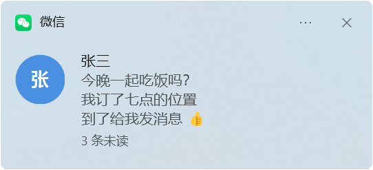

# WeChat Notifier

把微信（Windows 版 4.1）的新消息变成 Windows 11 原生通知：会话名、头像、消息内容、图片预览，点一下就打开对应的会话。全部在本机完成——不联网、不注入、不修改微信，也不读取微信的数据库。

*Native Windows 11 notifications for WeChat for Windows (Weixin 4.1): conversation, avatar, message text and picture preview, click to open the chat. Local only — no network, no injection, no changes to WeChat, no database access; it reads what WeChat shows through public Windows APIs (UI Automation).*



<sub>示例中的会话和消息是虚构的。</sub>

当前版本 **0.8.0**，每个版本的变化见 [CHANGELOG.md](CHANGELOG.md)。

## 功能

- **Windows 原生通知**（Windows App SDK）：跟随深色/浅色模式、勿扰模式和通知中心，每个会话只占一条通知
- **会话名、圆形头像、消息内容**；群聊显示「发送者: 内容」，被 @ 时标出「[有人@我]」
- **连续消息逐行显示**：同一会话连发几条，通知里从上到下列出最近 3 条，第 4 条来时最早的一条移出
- **图片预览**：会话正打开、窗口在屏幕上时，把收到的图片放进通知
- **点击通知**：打开微信并切换到那个会话；在微信里读过之后，通知自动从通知中心撤回
- **以「微信」的名义显示**：通知顶部是「微信」和微信的图标（可在设置里关闭）
- 托盘图标、暂停通知、开机启动，WinUI 3 设置窗口；头像、图片和图标按主显示器的缩放比例生成，不会被 Windows 缩放出锯齿

## 通知能显示什么

程序读的是微信窗口里显示的内容，所以取决于微信窗口的状态：

| 微信的状态 | 通知内容 |
|---|---|
| 窗口可见（不在前台）或最小化 | 会话名 + 消息内容 + 未读数（打开中的会话显示全文） |
| 关到托盘，或停在「发现」「通讯录」等页 | 会话名 + 「新消息」+ 未读数 |
| 在前台（你正在看微信） | 不通知 |

想在后台也看到内容：用最小化（—）代替关闭（×）。

## 安装

1. 打开 [Releases](../../releases/latest)，在最新版本最下面的 **Assets** 里下载 `WeChatNotifierSetup-<版本>.exe`（约 91 MB）
2. 双击运行，点「是」。完成后程序已在后台运行，之后随 Windows 启动

不用事先安装任何东西，也不联网下载：.NET 运行时和 Windows App Runtime（微软的通知组件）都在这个 exe 里，电脑上缺 Windows App Runtime 时顺便装上（第一次大约一分钟）。

- 系统要求：Windows 10 1809 或更新（推荐 Windows 11），x64；微信 Windows 版 4.1（在 4.1.13.65 上开发和测试）
- 只为当前用户安装到 `%LOCALAPPDATA%\Programs\WeChatNotifier`，**不需要管理员权限**
- 安装程序没有数字签名，第一次运行时 SmartScreen 可能提示「Windows 已保护你的电脑」→「更多信息」→「仍要运行」
- 更新：运行新版本的安装程序（设置保留）。卸载：设置 → 应用 → 已安装的应用 → WeChat Notifier（Windows App Runtime 是系统共用的组件，卸载时保留）

也可以[自己构建](#从源码构建)。

## 使用

程序在后台运行，没有主窗口。托盘图标在任务栏右下角的「显示隐藏的图标」（^）里：

- **单击**：打开设置窗口
- **右键**：暂停通知（30 分钟 / 1 小时 / 直到恢复）、发送测试通知、重新启动监听、诊断信息、退出

设置窗口跟随 Windows 的深色/浅色模式，改动立即生效：

| 页面 | 内容 |
|---|---|
| 常规 | 开机时启动、显示托盘图标、微信在前台时也通知 |
| 通知 | 消息内容、图片预览、头像、群聊消息、免打扰的会话、以「微信」的名义显示、声音、停留时间、点击后打开会话 |
| 隐私 | 临时图片缓存（可关闭、可清除）、调试日志、打开日志文件夹 |
| 高级 | 运行状态和延迟、测试通知、重新启动监听、复制诊断信息 |

横幅、锁屏显示、勿扰和优先级由 Windows 管理：设置 → 系统 → 通知。不要以管理员身份运行——Windows 不显示来自提升权限进程的通知。

## 隐私

- **不联网**：没有遥测、崩溃上报或更新检查
- **只用 Windows 公开接口**观察微信窗口：任务栏闪烁通知、UI Automation、窗口截图（`PrintWindow`）。不注入、不 hook、不修改 `Weixin.exe`，不读取微信的数据库、内存或网络流量
- **聊天内容只在内存里**，日志不含聊天内容
- 头像和图片预览只作为临时文件放在 `%LOCALAPPDATA%\WeChatNotifier`，自动清理；可以在设置里关闭

详见 [docs/privacy.md](docs/privacy.md)。

## 已知限制

- 微信在托盘里或停在其他页时，读不到消息内容（见上表）
- 图片预览只在那个会话正打开、窗口在屏幕上时才有
- 开机后微信从没打开过窗口时，只能显示「微信 · 收到新消息」；打开一次微信窗口后恢复正常
- 依赖微信的界面结构：微信改版后可能要更新识别规则（用 `tools/WeChatInspector` 检查）

完整列表见 [docs/limitations.md](docs/limitations.md)。

## 工作原理

微信每收到一条消息都会闪烁任务栏按钮（在托盘里也一样）。程序用 Shell hook 收到闪烁后，通过 UI Automation 定点读取会话列表，和上次读到的比较找出新消息，再用 Windows App SDK 的 `AppNotificationManager` 弹出通知。平时完全靠事件驱动，空闲时不占 CPU。详见 [docs/architecture.md](docs/architecture.md)。

## 从源码构建

需要 [.NET 10 SDK](https://dotnet.microsoft.com/download/dotnet/10.0)（`winget install Microsoft.DotNet.SDK.10`）。

```powershell
.\scripts\build.ps1                                          # 构建
dotnet test --project tests\WeChatNotifier.Tests -c Release  # 单元测试
.\scripts\package.ps1                                        # 安装程序 → artifacts\WeChatNotifierSetup-<版本>.exe
```

开发工具（控制台宿主、WeChatInspector）和文档索引见 [docs/development.md](docs/development.md)。推送到 GitHub 后，[GitHub Actions](.github/workflows/build.yml) 会构建、测试、打包；推送 `v*` 标签时把安装程序发布到 Releases。

## 项目结构

```
src/
  WeChatNotifier.Core           消息模型、去重、通知文字组装、图像处理、设置（纯逻辑）
  WeChatNotifier.Diagnostics    隐私安全的日志、指标、脱敏
  WeChatNotifier.Listener       发现微信、Shell hook、UI Automation 读取、会话差分、点击后打开会话
  WeChatNotifier.Notifications  Windows App SDK 原生通知：注册、显示、撤回、点击
  WeChatNotifier.App            后台程序 WeChatNotifier.exe：托盘、开机启动、单实例
  WeChatNotifier.Settings       设置窗口 WeChatNotifier.Settings.exe（WinUI 3，只在打开时运行）
  WeChatNotifier.Setup          安装程序 WeChatNotifierSetup.exe（.NET Framework 4.7.2，内含程序文件和 Windows App Runtime）
  WeChatNotifier.ConsoleHost    控制台宿主（诊断用，不随安装程序发布）
tests/WeChatNotifier.Tests      单元测试（xUnit v3）
tools/WeChatInspector           研究和诊断工具：检查微信的界面结构
scripts/                        build.ps1、package.ps1、make-icons.ps1
docs/                           架构、限制、隐私、性能、测试清单、开发指南
```

## 声明

本项目与腾讯公司无关，也未经其认可。「微信」「WeChat」及其图标是腾讯公司的商标。通知中显示的微信图标在运行时从你电脑上已安装的微信程序读取，本仓库和安装程序都不包含腾讯的任何文件。这是个人工具，按现状提供，不作任何保证。

## 许可证

[GPL-3.0](LICENSE) © 2026 Yu Wen。可以使用、修改和再发布；修改后再发布的版本也必须以 GPL-3.0 开源，并附上源代码。
